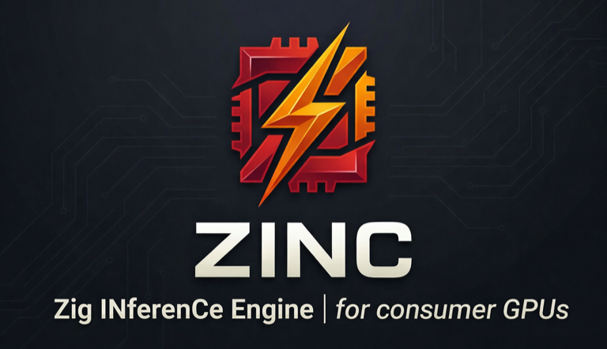
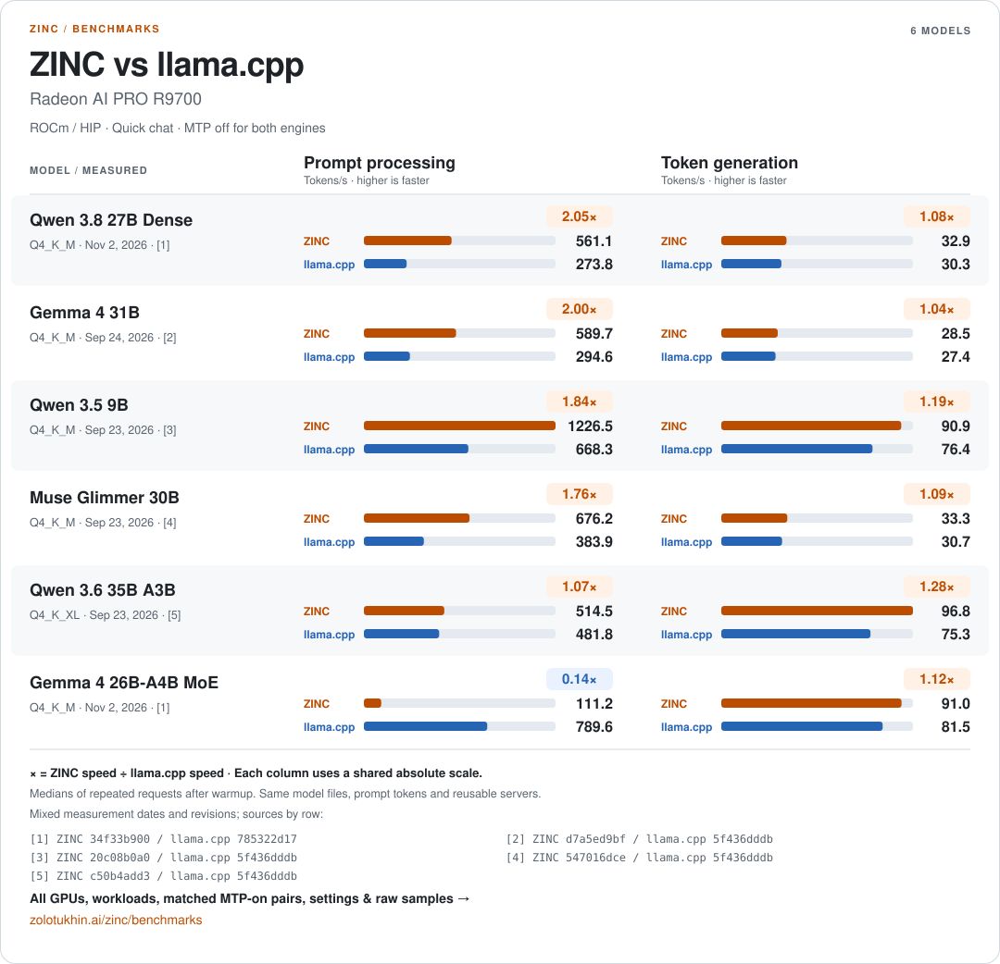

<p align="center">
  
</p>

# ZINC

Fast, local GGUF inference for the GPUs people already own. ZINC is one Zig
binary with a command line, browser chat, model manager, and OpenAI-compatible
API.

<p>
  <a href="https://github.com/zolotukhin/zinc/actions/workflows/test.yml"></a>
  <a href="https://zolotukhin.ai/zinc"></a>
  <a href="https://discord.gg/QRUgWH2aGV"></a>
  <a href="LICENSE"></a>
</p>

[Get started](https://zolotukhin.ai/zinc/docs/getting-started/) ·
[See every benchmark](https://zolotukhin.ai/zinc/benchmarks/#rdna-rocm) ·
[Read the docs](https://zolotukhin.ai/zinc/docs/) ·
[Join Discord](https://discord.gg/QRUgWH2aGV)

## Get running

**Start with Inkling 2 Mini Q4_0** on the Radeon RX 9070 XT or Radeon AI PRO
R9700. The managed checkpoint runs text generation at a 4,096-token context.
Use ROCm for the highest measured decode rate on both cards.
[Inkling 2 Mini AMD benchmarks](site/src/content/posts/2026-11-26-inkling-2-mini-amd-rx-9070-xt-radeon-ai-pro-r9700-benchmarks.md)

These commands use the Inkling development branch, Zig 0.15.2 or newer, and
the ROCm development libraries. [ROCm setup guide](docs/ROCM.md)

```bash
git clone --branch fix/qwen-smoke-token-anchor https://github.com/zolotukhin/zinc.git
cd zinc
ROCM_PATH=/opt/rocm zig build -Dbackend=rocm -Doptimize=ReleaseFast
./zig-out/bin/zinc --check
./zig-out/bin/zinc model pull inkling-2-mini-q4-0
./zig-out/bin/zinc --model-id inkling-2-mini-q4-0 --context 4096 \
  --chat --prompt "Explain how a write-ahead log works." -n 256
```

Both cards can also run Inkling with Vulkan. For Intel Arc, Apple Silicon, or a
smaller model, start with Qwen 3.5 9B where it appears in `zinc model list`.
[Getting started](docs/GETTING_STARTED.md)

## Faster on the hardware we test

ZINC beats the comparison llama.cpp build on **prefill, decode, and combined
time for all six models** in the current Radeon AI PRO R9700 ROCm core suite.
Both engines use the same GPU, GGUF files, prompts, reusable servers, warmups,
and measured run counts.

<a href="https://zolotukhin.ai/zinc/benchmarks/#rdna-rocm">
  
</a>

That is a scoped, reproducible result—not a claim about every model or GPU.
The [live benchmark page](https://zolotukhin.ai/zinc/benchmarks/#rdna-rocm)
includes all four workloads, raw samples, exact prompts, build revisions, and
the checked-in JSON.

## Supported GPU paths

- AMD Radeon: Vulkan and ROCm/HIP
- Intel Arc: Vulkan
- Apple Silicon: Metal
- NVIDIA RTX: experimental CUDA

Backends have native kernels and are measured separately. The
[hardware guide](https://zolotukhin.ai/zinc/docs/hardware-requirements/) keeps
the validated cards, drivers, memory requirements, and current limitations in
one place.

## Models

ZINC works with local GGUF files and a managed model catalog. Run
`zinc model list` for models validated on your GPU. The catalog also covers
Qwen 3.5, Qwen 3.6, Qwen 3.8, Gemma 4, and Muse Glimmer.

You can also point directly at a file or Hugging Face repository:

```bash
./zig-out/bin/zinc -m /path/to/model.gguf --prompt "The capital of France is"
./zig-out/bin/zinc -hf unsloth/Qwen3.8-27B-GGUF:Q4_K_M --prompt "Hello" --chat
```

## Local server and API

```bash
./zig-out/bin/zinc --model-id inkling-2-mini-q4-0 --context 4096 --parallel 1 --port 9090
```

This starts the OpenAI-compatible API. Health checks are at `/health`, and
model listing and chat completions are under `/v1`. On Vulkan, open the browser
chat at `http://localhost:9090/`. [API guide](docs/API.md)

## Build, test, contribute

```bash
zig build -Doptimize=ReleaseFast
zig build test
```

Benchmark claims come from `tools/performance_suite.mjs`; published artifacts
live in `site/src/data/zinc-performance.json`. Start with the
[development guide](docs/DEVELOPMENT.md) and [contributing guide](CONTRIBUTING.md).

ZINC is active engineering work. If a model or GPU path is incomplete, the
benchmark page leaves that result visible instead of quietly dropping it.

MIT licensed.
