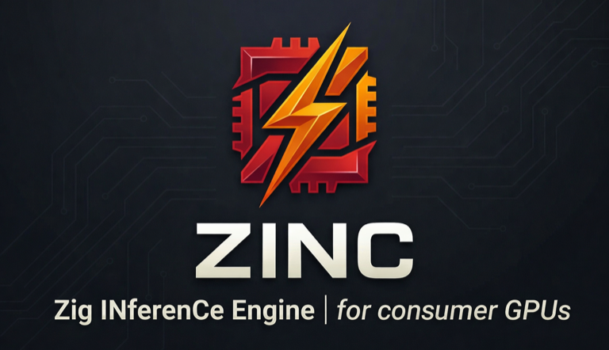
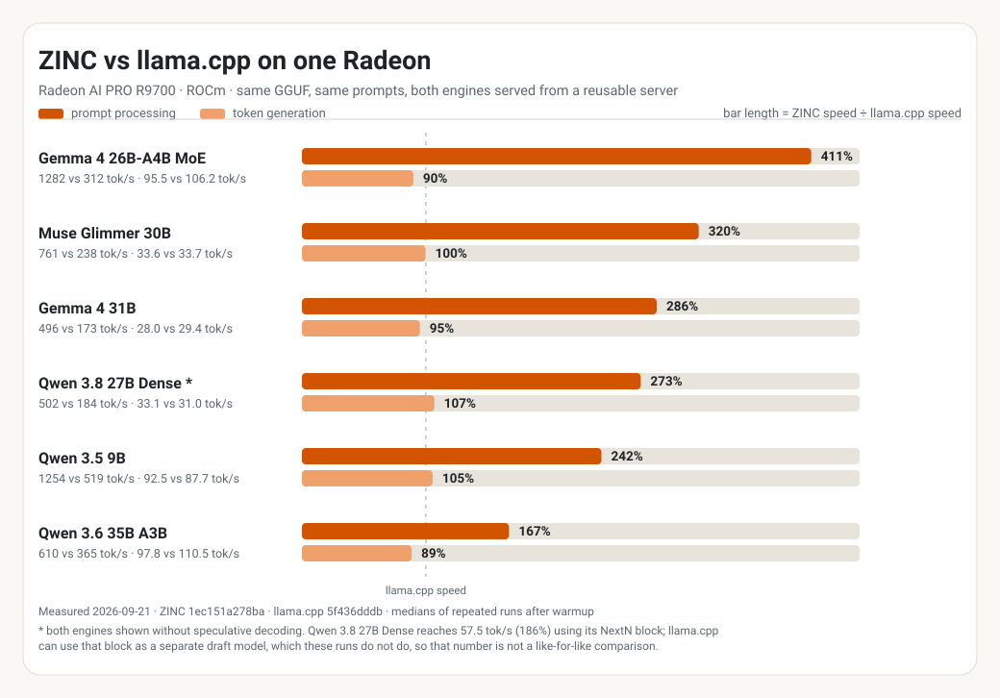

<p align="center">
  
</p>

# ZINC

Run GGUF language models on your own GPU. ZINC gives you a command line,
browser chat, and an OpenAI-compatible API in one native binary.

[](https://github.com/zolotukhin/zinc/actions/workflows/test.yml)
[](.zig-version)
[](LICENSE)

[Get started](https://zolotukhin.ai/zinc/docs/getting-started/) ·
[Documentation](https://zolotukhin.ai/zinc/docs/) ·
[Benchmarks](https://zolotukhin.ai/zinc/benchmarks/) ·
[Discord](https://discord.gg/QRUgWH2aGV)

## Get running

Install the [prerequisites for your GPU](https://zolotukhin.ai/zinc/docs/getting-started/#install-dependencies)
first. The default build uses **Vulkan on Linux** and **Metal on macOS**.
The build wrapper downloads and verifies **Zig 0.17.0** when needed; you do not
need to replace your system compiler. Python 3 is needed for that initial
compiler download.

```bash
git clone https://github.com/zolotukhin/zinc.git
cd zinc
./scripts/zig.sh build -Doptimize=ReleaseFast
```

On AMD with Vulkan, set `export RADV_PERFTEST=coop_matrix` in the same terminal
before the GPU check or inference. Then check your GPU, download a model, and
open the chat:

```bash
./zig-out/bin/zinc --check
./zig-out/bin/zinc model pull qwen35-9b-q4k-m
./zig-out/bin/zinc chat --model-id qwen35-9b-q4k-m
```

The example uses Qwen 3.5 9B. Check the
[memory requirements](https://zolotukhin.ai/zinc/docs/hardware-requirements/)
before downloading, or run `./zig-out/bin/zinc model list` to browse the catalog.
You can also load an existing file with `-m /path/to/model.gguf`.

## Choose your GPU path

| Hardware                   | Backend             | Setup                                                                                                      |
| -------------------------- | ------------------- | ---------------------------------------------------------------------------------------------------------- |
| AMD Radeon RDNA3 / RDNA4   | Vulkan or ROCm/HIP  | [Vulkan](https://zolotukhin.ai/zinc/docs/getting-started/) · [ROCm](https://zolotukhin.ai/zinc/docs/rocm/) |
| Apple Silicon              | Metal               | [macOS](https://zolotukhin.ai/zinc/docs/getting-started/#macos-apple-silicon)                              |
| Intel Arc Xe2 / Battlemage | Vulkan              | [Intel guide](https://zolotukhin.ai/zinc/docs/intel-gpu-reference/)                                        |
| NVIDIA RTX                 | CUDA · experimental | [Requirements](https://zolotukhin.ai/zinc/docs/hardware-requirements/)                                     |

For AMD with a working ROCm installation, choose the HIP backend at build time:

```bash
ROCM_PATH=/opt/rocm ./scripts/zig.sh build -Dbackend=rocm -Doptimize=ReleaseFast
ROCR_VISIBLE_DEVICES=0 ./zig-out/bin/zinc --check
```

Model coverage and performance vary by backend. The
[hardware guide](https://zolotukhin.ai/zinc/docs/hardware-requirements/) lists
validated cards, operating systems, drivers, and current limitations.

## Use it your way

**Browser chat** in the default Vulkan or Metal build starts the UI and local API together:

```bash
./zig-out/bin/zinc chat --model-id qwen35-9b-q4k-m
```

**One prompt** from the terminal:

```bash
./zig-out/bin/zinc --model-id qwen35-9b-q4k-m --chat --prompt "Explain a ring buffer."
```

**An existing app** can connect to `http://localhost:9090/v1` while the server
is running. The [API guide](https://zolotukhin.ai/zinc/docs/api/) has curl and
SDK examples; endpoint coverage varies by backend.

The managed catalog includes Qwen, Gemma, and other tested model families.
See [model selection](https://zolotukhin.ai/zinc/docs/getting-started/#models-in-current-work)
for checkpoints, memory needs, and the exact Muse Glimmer GGUF used in testing.

## Coding harnesses

Connect **OpenCode** to a running ZINC server with the
[setup script](tools/setup_opencode.mjs). It creates a portable config, checks
chat and streaming tool calls, and runs headless tasks:

```bash
bun install --global opencode-ai@1.19.4
bun tools/setup_opencode.mjs --project ../my-project --model qwen38-27b-q4k-m --context 32768
bun tools/setup_opencode.mjs check --project ../my-project
bun tools/setup_opencode.mjs run --project ../my-project --auto \
  --verify 'bun test' -- "Fix the failing tests and run them."
```

Start ZINC with `-c 32768 --parallel 1` to match this repository-task example.
Setup defaults to 16K; always match the actual server context. Use setup-only
`--context auto` to discover it from a running server. Replace `bun test`
with the project's acceptance command. Failed checks feed real diagnostics
back into short editing rounds; a failed check cannot produce a successful
harness exit. The config uses localhost; custom endpoints
and API keys come from environment variables at runtime.
[Setup, worktrees, and task evaluation](https://zolotukhin.ai/zinc/docs/opencode/) ·
[Download the standalone script](https://zolotukhin.ai/zinc/harnesses/setup-opencode.mjs)

The [full-worktree trial](docs/OPENCODE_WORKTREE_REPORT.md) records the original
coding failures. The [ROCm follow-up](docs/ROCM_AGENT_CONTEXT.md) documents the
memory/attention fixes, prompt reuse, and separate coding acceptance results.
The [end-to-end report](docs/OPENCODE_E2E_REPORT.md) compares actual repository
tasks at 262K Q8 and 32K FP32 capacity, including incomplete delivery and review findings.
The [technical write-up](https://zolotukhin.ai/blog/2026-10-26-from-fast-tokens-to-a-verified-coding-task-on-rdna4/)
explains the failures, fixes, and reviewed feature result.

Qwen 3.8 27B supports a **262,144-token** window. The 32K example above is the
tested coding-task configuration. The [native-context guide](docs/ROCM_NATIVE_CONTEXT.md)
explains the opt-in Q8 cache, precision choices and larger-context validation
on a 32GB ROCm card. Match the harness context to the server when changing it.

## Inspect the performance

The chart compares six models on the same Radeon AI PRO R9700, with **ROCm on
both ZINC and llama.cpp**. Both engines use the same GGUF files, prompt tokens,
reusable servers, warmups, and repeat counts.

<a href="https://zolotukhin.ai/zinc/benchmarks/#rdna-rocm">
  
</a>

Speculative decoding is **off for both engines** in this chart. The
[benchmark dashboard](https://zolotukhin.ai/zinc/benchmarks/) includes every
workload, GPU, sample spread, build revision, and the speculative-decoding
on/off measurements. It also retains incomplete results and cases where
llama.cpp is ahead.

The chart is generated from
[`zinc-performance.json`](site/src/data/zinc-performance.json).
[Reproduce the suite](docs/BENCHMARKING.md), or read the latest
[27B MTP follow-up](docs/ROCM_MTP_0_17.md): 71.17 → 77.04 tok/s on its long
coding workload compared with the previous ZINC build.

## Build and contribute

JavaScript tooling requires **Bun 1.4.4 or newer**, pinned in [`.bun-version`](.bun-version).
Use `bun run format` to format changed files with `bun fmt`.

```bash
./scripts/zig.sh build test
```

[Development guide](docs/DEVELOPMENT.md) ·
[Contributing](CONTRIBUTING.md) ·
[Zig 0.17 migration](docs/ZIG_0_17_MIGRATION.md) ·
[Performance follow-up](docs/ZIG_0_17_BPE.md)
