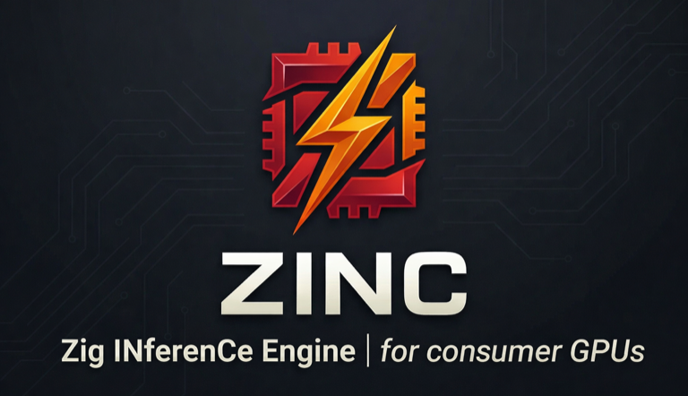
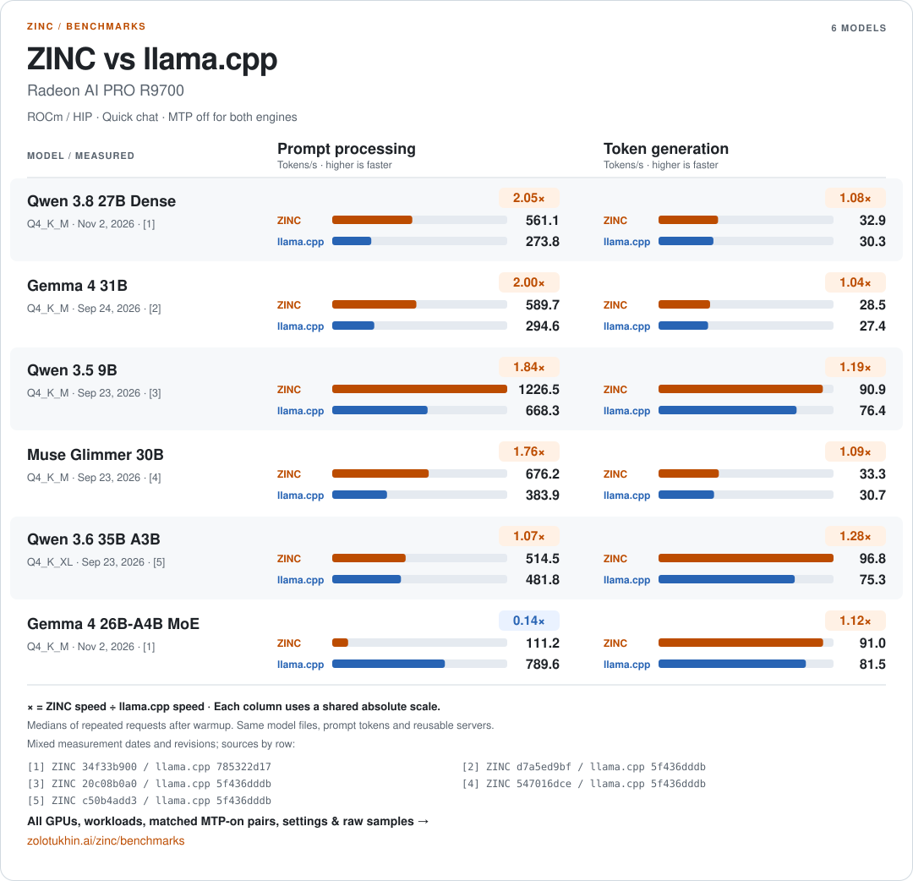

<p align="center">
  
</p>

# ZINC

Run GGUF language models on your own GPU. ZINC gives you a command line
and an OpenAI-compatible API in one native binary. Vulkan and Metal builds
also include browser chat.

[](https://github.com/zolotukhin/zinc/actions/workflows/test.yml)
[](.zig-version)
[](LICENSE)

[Get started](https://zolotukhin.ai/zinc/docs/getting-started/) ·
[Documentation](https://zolotukhin.ai/zinc/docs/) ·
[Benchmarks](https://zolotukhin.ai/zinc/benchmarks/) ·
[Discord](https://discord.gg/QRUgWH2aGV)

## Get running

For published archives, runtime requirements and verified installation/rollback,
see [binary releases](https://zolotukhin.ai/zinc/docs/binary-releases/) and
[GitHub Releases](https://github.com/zolotukhin/zinc/releases).
[Linux 0.1.0](https://github.com/zolotukhin/zinc/releases/tag/v0.1.0)
is available for Vulkan and ROCm. The exact published binaries pass all three
GPU profiles and public installation checks; see the
[release record](docs/releases/0.1.0-plan.md).
The commands below build from source.

Install the [prerequisites for your GPU](https://zolotukhin.ai/zinc/docs/getting-started/#install-dependencies)
first. The default build uses **Vulkan on Linux** and **Metal on macOS**.
The build wrapper downloads and verifies **Zig 0.17.0** when needed; you do not
need to replace your system compiler. Python 3 is needed for that initial
compiler download.

```bash
git clone https://github.com/zolotukhin/zinc.git
cd zinc
./scripts/zig.sh build -Doptimize=ReleaseFast
```

On AMD with Vulkan, set `export RADV_PERFTEST=coop_matrix` in the same terminal
before the GPU check or inference. Then check your GPU, download a model, and
open the chat:

```bash
./zig-out/bin/zinc --check
./zig-out/bin/zinc model pull qwen35-9b-q4k-m
./zig-out/bin/zinc chat --model-id qwen35-9b-q4k-m
```

The example uses Qwen 3.5 9B. Check the
[memory requirements](https://zolotukhin.ai/zinc/docs/hardware-requirements/)
before downloading, or run `./zig-out/bin/zinc model list` to browse the catalog.
You can also load an existing file with `-m /path/to/model.gguf`.

## Choose your GPU path

| Hardware                            | Backend             | Setup                                                                         |
| ----------------------------------- | ------------------- | ----------------------------------------------------------------------------- |
| AMD Radeon RDNA3 / RDNA4            | Vulkan              | [Linux Vulkan setup](https://zolotukhin.ai/zinc/docs/getting-started/)        |
| AMD Radeon AI PRO R9700 (`gfx1201`) | ROCm/HIP            | [Validated ROCm setup](https://zolotukhin.ai/zinc/docs/rocm/)                 |
| Apple Silicon                       | Metal · preview     | [macOS](https://zolotukhin.ai/zinc/docs/getting-started/#macos-apple-silicon) |
| Intel Arc Xe2 / Battlemage          | Vulkan              | [Intel guide](https://zolotukhin.ai/zinc/docs/intel-gpu-reference/)           |
| NVIDIA RTX                          | CUDA · experimental | [Requirements](https://zolotukhin.ai/zinc/docs/hardware-requirements/)        |

Each binary contains one backend; there is no runtime switch or automatic
fallback between Vulkan and ROCm. For a validated AMD ROCm stack, choose HIP
at build time:

```bash
ROCM_PATH=/opt/rocm ./scripts/zig.sh build -Dbackend=rocm -Doptimize=ReleaseFast
./zig-out/bin/zinc --check
```

Model coverage and performance vary by backend. The
[hardware guide](https://zolotukhin.ai/zinc/docs/hardware-requirements/) lists
validated cards, operating systems, drivers, and current limitations.

## Use it your way

**Browser chat** in the default Vulkan or Metal build starts the UI and local API together:

```bash
./zig-out/bin/zinc chat --model-id qwen35-9b-q4k-m
```

**One prompt** from the terminal:

```bash
./zig-out/bin/zinc --model-id qwen35-9b-q4k-m --chat --prompt "Explain a ring buffer."
```

**An existing app** can connect to `http://localhost:9090/v1` while the server
is running. The [API guide](https://zolotukhin.ai/zinc/docs/api/) has curl and
SDK examples; [endpoint coverage differs by backend](https://zolotukhin.ai/zinc/docs/api/#backend-coverage).

The managed catalog includes Qwen, Gemma, and other tested model families.
See [model selection](https://zolotukhin.ai/zinc/docs/getting-started/#models-in-current-work)
for checkpoints, memory needs, and the exact Muse Glimmer GGUF used in testing.

## Coding harnesses

Connect **OpenClaw** with the [dedicated setup helper](tools/setup_openclaw.mjs):

```bash
npm install --global openclaw@2026.11.1
node tools/setup_openclaw.mjs setup --project ../my-project
node tools/setup_openclaw.mjs check --project ../my-project
node tools/setup_openclaw.mjs run --project ../my-project -- "Fix the failing tests and run them."
```

Use Node 24.16+ in the 24.x line, or Node 26.1+, and start ZINC first. The
[OpenClaw guide](https://zolotukhin.ai/zinc/docs/openclaw/) covers server contexts,
isolated task state, endpoint discovery, and independent verification.

Connect **OpenCode** to a running ZINC server with the
[setup script](tools/setup_opencode.mjs). It creates a portable config, checks
chat and streaming tool calls, and runs headless tasks:

```bash
bun add --global --trust @opencode/cli@2.0.21
bun tools/setup_opencode.mjs --project ../my-project --model qwen35-9b-q4k-m \
  --context auto --output 2048 --steps 16
bun tools/setup_opencode.mjs check --project ../my-project
bun tools/setup_opencode.mjs run --project ../my-project --auto \
  --verify 'bun test' -- "Fix the failing tests and run them."
```

Start Qwen 3.5 9B with `-c 16384 --parallel 1` for this example. Setup-only
`--context auto` discovers the running server's capacity; it does not allocate
more GPU memory. The [Intel model matrix](docs/INTEL_OPENCODE_VALIDATION.md)
records each model's tested context, task outcomes and limits. Replace `bun test`
with the project's acceptance command. Failed checks feed real diagnostics
back into short editing rounds; a failed check cannot produce a successful
harness exit. The config uses localhost; custom endpoints
and API keys come from environment variables at runtime.
[Setup, worktrees, and task evaluation](https://zolotukhin.ai/zinc/docs/opencode/) ·
[Download the standalone script](https://zolotukhin.ai/zinc/harnesses/setup-opencode.mjs)

The [end-to-end report](docs/OPENCODE_E2E_REPORT.md) records real repository
trials, review findings, and incomplete deliveries. The
[technical write-up](https://zolotukhin.ai/blog/2026-10-26-from-fast-tokens-to-a-verified-coding-task-on-rdna4/)
explains the failures, fixes, and reviewed feature result.

Qwen 3.8 27B supports a **262,144-token** window. Its separate ROCm repository
trials use 32K context; the [native-context guide](docs/ROCM_NATIVE_CONTEXT.md)
explains the opt-in Q8 cache, precision choices and larger-context validation
on a 32GB ROCm card. Match the harness context to the server when changing it.

## Inspect the performance

Compare prompt processing and token generation on one **Radeon AI PRO R9700**,
with **ROCm on both engines**. Orange is ZINC; blue is llama.cpp. Speeds are
tokens per second, and each badge shows ZINC speed divided by llama.cpp speed.

<a href="https://zolotukhin.ai/zinc/benchmarks/#rdna-rocm">
  <picture>
    <source media="(max-width: 767px) and (prefers-color-scheme: dark)" srcset="assets/rocm-r9700-benchmark-mobile-dark.svg">
    <source media="(max-width: 767px)" srcset="assets/rocm-r9700-benchmark-mobile.svg">
    <source media="(prefers-color-scheme: dark)" srcset="assets/rocm-r9700-benchmark-dark.svg">
    
  </picture>
</a>

Speculative decoding is **off for both engines** in this chart. The
[benchmark dashboard](https://zolotukhin.ai/zinc/benchmarks/) includes every
workload, GPU, sample spread, build revision, and the speculative-decoding
on/off measurements. Each row shows both engines' MTP settings. Different or
unrecorded settings and correctness cautions are excluded from ratios. It also
retains incomplete results and cases where llama.cpp is ahead.

New campaigns [refresh and verify the latest llama.cpp](docs/BENCHMARKING.md#latest-llamacpp-and-matched-mtp-pairs)
and measure **on/on and off/off**; older measurements retain their original
build revisions and dates.

The chart uses the same GGUF files, prompt tokens, reusable servers, warmups,
and repeat counts for both engines. Dates and builds vary by model and are
shown in the graphic. Regenerate all four variants from
[`zinc-performance.json`](site/src/data/zinc-performance.json) with
`bun tools/render_benchmark_svg.mjs --readme`.
[Reproduce the suite](docs/BENCHMARKING.md), or read the
[matched 27B MTP comparison](docs/MATCHED_MTP_LLAMA_CPP.md) against current
llama.cpp, including the output controls that still need investigation.
The [fresh Gemma MoE measurements](docs/ROCM_GEMMA_MOE_PREFILL.md#fresh-r9700-measurements)
include the partial-tile fix, full reference checks, and restored batched prefill.
The [fresh Vulkan Gemma measurements](docs/VULKAN_GEMMA_SLIDING_WINDOW.md#fresh-vulkan-measurements)
cover both Gemmas on AMD and Intel, with full reference/recovery checks and
matched MTP-off server comparisons against the latest pre-campaign llama.cpp.
The earlier [Zig 0.17 MTP optimization study](docs/ROCM_MTP_0_17.md) records a
separate comparison between two ZINC builds.

## Build and contribute

JavaScript tooling requires **Bun 1.4.4 or newer**, pinned in [`.bun-version`](.bun-version).
Use `bun run format` to format changed files with `bun fmt`.

```bash
./scripts/zig.sh build test
```

[Development guide](docs/DEVELOPMENT.md) ·
[Contributing](CONTRIBUTING.md) ·
[Zig 0.17 migration](docs/ZIG_0_17_MIGRATION.md) ·
[Performance follow-up](docs/ZIG_0_17_BPE.md)
