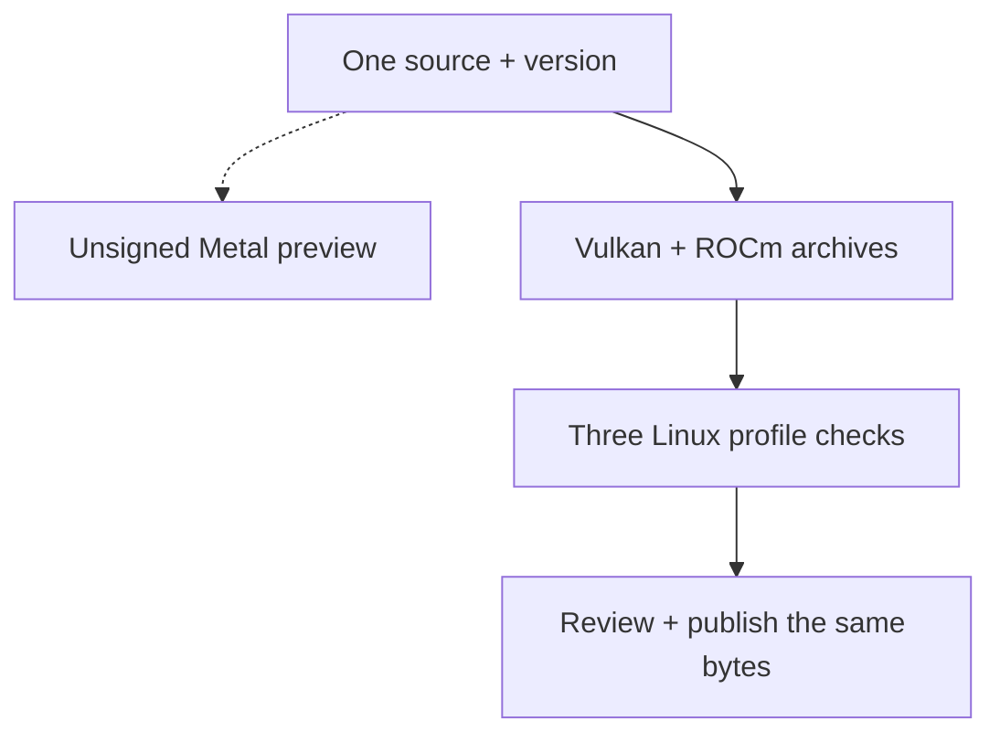

The command-line version of ZINC said “fridge.” The HTTP server said “box.”

Both were answering the same refrigerator prompt, with the same model weights, greedy decoding and one request slot on our 32 GB Radeon AI PRO R9700. Each answer sounded reasonable. The difference sent us into the GPU execution paths while preparing **ZINC 0.1.0, our first stable release for local LLM inference**.

A short prompt had found a disagreement that a fluent paragraph could hide. Following it led through request history, memory allocation, the test harness and eventually the reference executable itself.

**November 3 update:** [ZINC 0.1.0 is available](https://github.com/zolotukhin/zinc/releases/tag/v0.1.0) for Linux Vulkan and ROCm. Metal remains an unsigned preview. The work below made the meaning of “stable” much more concrete.

## A request can inherit more than conversation history

An inference engine first processes the prompt, called **prefill**, then generates tokens one at a time. ZINC has several ways to execute those operations. Their floating-point reductions can produce slightly different numbers, enough to change a greedy choice when two words are close.

Our Qwen mixture-of-experts path exposed that distinction on a **19-token prompt**. The command line used batched prefill with one state-space scan; the server selected a different path for short prompts. We brought the configured single-slot ROCm paths into agreement and added tests around the short-prompt boundary.

Then the stronger checks found something less obvious. A dense model could give the expected answer, process a long request, and give a different answer to the original short prompt afterward.

The long request had allocated scratch buffers. Later decode code treated the buffers’ existence as permission to use a different arithmetic path. The allocation was cached, so the next request inherited that decision.

| Trigger                                    | What we found                                   | What the regression now checks                         |
| ------------------------------------------ | ----------------------------------------------- | ------------------------------------------------------ |
| The same short prompt through CLI and HTTP | Different short-prompt execution paths          | Complete frozen continuations through both entrypoints |
| A short request after a long one           | Cached scratch changed decode eligibility       | Correct short answers after context and error recovery |
| An 8K coding session with Gemma 31B        | Weights and cache fit, prompt scratch did not   | Chunked prefill with preserved positions and history   |
| A clean reference checkout                 | Its server executable reported another revision | Executable identity and unchanged reference libraries  |

_Four release-testing clues. Each became a test that exercises the condition which exposed the failure._

The scratch buffers can remain cached. The permission to use a particular decode path now belongs to the current request. That distinction is small in code and consequential in a server that keeps running between users’ requests.

Our [single-slot consistency report](/zinc/docs/rocm-single-slot-correctness/) records the controls and fixes. The test sequence now asks the short questions again after cancellation, a nearly full context, malformed JSON and an oversized request. It compares complete reference continuations, including whitespace.

A healthy endpoint and a nonempty answer would have missed this bug.

## Fitting the model was only the first memory budget

Gemma 4 31B presented a different problem. On the R9700, the model and its 8K key/value cache could load, but whole-prompt prefill needed more temporary memory than remained. The fallback processed the prompt serially. One captured **5,037-token OpenCode request spent about 199 seconds in that fallback before its first response**.

The [bounded prefill fix](/zinc/docs/rocm-gemma-bounded-prefill/) tries smaller scratch allocations before executing any prompt layer. It halves the capacity until a workable chunk fits, with a defined minimum. Allocation failures can trigger that retry; execution and shape errors keep their original failure paths.

Each chunk must retain its absolute position and attend to the earlier chunks. Starting each chunk’s positions at zero would save memory while changing the computation. We therefore force tiny 16-token chunks in a separate regression and compare every continuation token and the full text with the reference. That exercises nonzero offsets and short final chunks even when the GPU has enough space for a larger allocation.

We also stopped reserving an unused 220.5 MiB workspace on the affected dense quantized path. On a crowded 32 GB card, an allocation needs a reason to exist.

## The coding client supplied a different kind of test

We ran actual OpenCode sessions against the packaged executable. The core fixtures asked for a rate limiter, a multi-file shopping cart and a Python NDJSON command-line tool. Independent acceptance tests failed before each task and ran again after the client exited. The model had to read, edit and invoke tools; the supervisor supplied no implementation edits or repaired model responses.

On preview `11519aaa`, Gemma 31B completed those three fixtures at 8K, passing all ten acceptance tests, with a **600-second budget per fixture**. The earlier 300-second trial remains recorded as a timeout. The context, deadline and executable identity travel with each result.

That evidence covers those bounded tasks. The [earlier repository trial](/blog/2026-10-26-from-fast-tokens-to-a-verified-coding-task-on-rdna4/) describes getting a feature through review, including tool-output limits and an initial green check that missed two contract violations.

## Intel found the distance between one token and 256

Moving the coding tests to an Intel Arc Pro B70 added another layer: the client itself had changed. OpenCode 2 removed a command-line option, changed plugin registration and started sending `max_completion_tokens`. Our older server understood `max_tokens` and silently ignored the newer spelling.

A request for **one token produced 256**. In a coding session, that default cut off tool arguments before the model had finished writing them. We added both budget spellings to the server, reject conflicting budgets, and exercise actual OpenCode 1.19.4 and 2.0.21 in CPU protocol tests. Those scripted tests establish client compatibility; they do not establish model ability.

The GPU supplied a separate surprise. A 64-thread workgroup is not necessarily one 64-lane subgroup. Gemma's expert router needed a complete workgroup reduction on Intel's smaller subgroups. A numerical test now checks that distinction against the reference instead of trusting a plausible answer.

After those fixes, the first Intel coding trial passed its independent acceptance tests and still failed as a client run. OpenCode timed out while ZINC continued prefill for an abandoned request. The next user could then wait behind work whose caller had already left.

Vulkan prefill now checks request liveness between tokens, chunks and layers. Controlled cancellations on the same Intel server recovered in **417–419 ms**. The subsequent Qwen 3.5, 3.6 and 3.8 trials completed all three core fixtures with the client exiting successfully, protected tests unchanged and a responsive server afterward. Their larger, 15-minute fixture budget remains part of the result.

Gemma exposed another boundary: an 8K window could trigger OpenCode's compaction before the first tool call, and the summary itself could exhaust the remaining output budget. Increasing a timeout cannot create context space. We retain those failures alongside the model-specific context settings in the [Intel investigation](/zinc/docs/intel-opencode-validation/).

Even a correct backend can get stuck at the client boundary. After Gemma's reference and API checks passed, its first OpenCode 2 retry spent 15 minutes trying imports and undiscovered tool names inside Code Mode's restricted JavaScript runtime. The task's tests never improved. We kept that failure and gave the local coding preset direct file and shell tools. The actual-client protocol tests check the advertised tool list, rather than assuming that a configuration field took effect.

That helped, but it did not make every model a reliable coding agent. With the corrected backend and the earlier launcher on Intel, Gemma 31B completed two of three fixtures at the same 15-minute budget; Gemma 26B completed one. The 31B Python task passed its independent tests but timed out before the client finished. We still count it as a failed run. The small starter completed none, and one attempt changed a protected file. The harness rejected it.

Then a longer trial exposed a mistake in our own launcher. The Python task eventually finished after almost half an hour. In its trace, an absolute file edit reached the fixture, but relative shell commands could not find `src` or `test`. The client spent turn after turn searching elsewhere.

We had set the child process's working directory and inherited its parent's `PWD`. OpenCode used the inherited variable to select its workspace. Our earlier scripted protocol tests used absolute file paths, so they had hidden the difference. The new test deliberately supplies the wrong `PWD`, then reads and writes relative files and checks a marker through the shell. Both tested OpenCode versions fail that control before the launcher fix and pass afterward, leaving the other directory's sentinel unchanged.

We retained the old GPU runs with that flawed launch context and started a fresh seven-model Intel matrix on one packaged executable. The engine had real bugs, the client had changed, and our harness could still make a correct model waste its time. Testing all three boundaries matters.

On that fresh launch, both Gemmas completed all three tasks within the original 15-minute limit, with independent tests passing and protected files unchanged. The 31B model used 12K context and took 2.0–6.5 minutes per task; the 26B mixture-of-experts model used 16K and took 10.9–12.6 minutes. Each server remained responsive and passed its native-reference replays afterward. Those are useful successes with different waiting times, and the [full report](/zinc/docs/intel-opencode-validation/) keeps the configuration beside the result.

The same investigation showed that every tool turn was sending its growing history without a ZINC session key. We checked the existing reuse path before enabling it automatically: both Gemmas reused more than 1,200 tokens on a tool-history turn and matched full prefill. An intervening request still produced the correct continuation. A hybrid Qwen control returned correct replies but could not restore its checkpoint, so automatic reuse stays off for recurrent models. The [packaged control](/zinc/validation/vulkan-session-reuse-packaged-control-2026-11-02.json) keeps both the successful reuse and the deliberate full-prefill fallback visible.

## Speculation needs a reference too

The fresh package then found another omission. Qwen 3.8 carries a NextN block for multi-token prediction, but it was absent from the earlier six-model Vulkan qualification roles. On Intel, the first six choices of a story matched the reference; the seventh did not. The alternative was outside our near-tie rule.

Changing cache precision did not help. Ordinary decode matched all 48 choices across the three reference prompts. A separate AMD control matched with speculation both on and off, so we kept AMD's passing default and made Intel's speculative verifier an explicit opt-in while it is investigated. Both Vulkan release roles now include this model. The new Intel-default package passes its complete short CLI and HTTP continuations before the coding matrix continues.

## Sometimes the small model finds a server bug

The starter also failed four API checks. It would have been easy to blame a 0.6B model for bad tool arguments. Following the bytes showed three host-side mistakes instead.

For a required single tool, we put the beginning of its call in the prompt so the model only has to continue it. The JSON response parser then inspected only the generated tail. A schema search could pick a nested object's required field instead of the call's outer argument. And the streaming fallback could turn an invalid continuation into an executable empty argument object.

We restored the prefix, parsed the schema structurally and made both transports use the same complete-call parser. Incomplete output stays text. The starter then passed all 29 API checks in a separate GPU control, alongside the 9B comparison. Its failed coding trials remain failed. In the fresh Intel matrix, it passes all 29 API probes but completes none of the three coding tasks. We then run the same tasks with actual OpenCode against the pinned native Vulkan engine, with the same model and client budgets. It also completes none. The reference's tests stay at baseline; the ZINC attempts include an unavailable tool, a removed export and a protected-file change. Both servers recover and retain their native continuations. A small model can expose an engine defect without becoming a model we recommend for repository work.

## The bug that waited until token 1,025

Gemma made the distinction between short answers and coding painfully concrete. We corrected its cache allocation, got the 31B model to start at 12K on Intel, and watched a coding request produce repetitive text without touching a file. All 48 short reference tokens still matched.

Gemma combines sliding attention with global attention. Its sliding layers discard keys at least 1,024 positions behind the query. Our Vulkan path had never passed that window into the attention shaders. Before the boundary, there was nothing for the missing mask to exclude. A short test could therefore pass while the computation was wrong for the source files and tool definitions in a real coding request.

A 9.2K filler prompt made the disagreement easy to see: ZINC repeated “word”; the native reference answered “OK.” We added 256 numerical cases that compare complete attention vectors, including permuted KV pages and batches crossing the window boundary. The old shaders fail that control. Both the Intel and AMD boards pass with the correction.

Then a longer native continuation caught another difference: dense Gemma's extra activation quantization chose “Wiring” where the reference chose “wiring,” outside our near-tie allowance. Keeping F32 activations during batched prefill restored the exact continuation. That approximation now requires an explicit opt-in.

The [window correction](/zinc/docs/vulkan-gemma-sliding-window/) now has numerical tests and complete reference continuations beyond the boundary, through both CLI and HTTP. Wiring those checks into readiness exposed another harness mistake: its model summary had copied the hash and context while dropping the window field. The extended-check branch never ran. A regression now rejects that short-only wiring, even when every short answer passes.

The [fresh automatic R9700 report](/zinc/validation/worker-readiness-window-gate-2026-11-02.json) matches all **432 short and extended CLI token choices exactly** across seven Vulkan models, with complete HTTP continuations and cleanup. Actual OpenCode outcomes remain their own check in the [Intel report](/zinc/docs/intel-opencode-validation/).

Requiring those longer references also caught a ROCm Gemma MoE disagreement that its short answers had missed. Full serial prefill restored the failing continuation, so that became the conservative default while we investigated batching. We retained the failed package and checked the serial default through all six models, including their HTTP responses and recovery. The [ROCm revalidation](/zinc/docs/rocm-gemma-moe-prefill/) and [Vulkan revalidation on AMD and Intel](/zinc/docs/vulkan-gemma-sliding-window/#fresh-vulkan-measurements) preserve the complete original measurements and cautions in their history.

On November 3, that investigation came down to 64 missing numbers. Gemma's expert down projection has 704 input columns. A fast kernel counted full tiles of 128, processed 640 columns, and quietly dropped the remaining 64. Its Q8 shared-expert cousin made the same assumption. The weight formats only require blocks of 32, so those model dimensions were perfectly valid.

We wrote a test whose useful weights exist entirely in the dropped tail. The old kernel returns zero; the native reference does not. The corrected kernels now pass 305 numerical and buffer-boundary cases, and the batched model matches all 96 checked native token choices, including the long continuations and HTTP recovery. We also kept routing in F32: selecting experts is sensitive to score differences that a projection cache should not round away.

With the same checks intact, the incident-context workload went from **98 to 3,703 prefill tokens per second**. In a fresh three-round ROCm comparison, ZINC measured 3,703 against llama.cpp's 2,542, and 98.8 against 75.1 decode tokens per second, with MTP off for both. The [full report](/zinc/benchmarks/2026-11-03T09-00-39-rdna-rocm-gemma4-26b-a4b-q4k-m-revalidated.json) pins the source, weights, reference builds and every sample. That is a model-specific source-build result; the release archive still has to earn its own qualification.

## Eventually we had to test the reference

The reference engine deserves the same scrutiny as ZINC.

During the latest R9700 validation, a HIP reference checkout was at the policy revision, `5f436dddb`. Its server executable reported `b96806d96`, an older ancestor. We had recorded the executable’s hash correctly in earlier reports, but also attached the intended checkout revision to it.

We corrected those reports. Their comparisons remain observations against the recorded executable bytes; the claim that this HIP executable verified the intended policy revision is withdrawn. The separately observed OpenCode fixture outcomes retain their own scope.

There was another surprise. Building a missing tokenizer tool replaced sibling shared libraries while leaving the server executable unchanged. Hashing the server alone would have missed that change.

The release checks now capture both executables and their adjacent ggml/llama libraries before the reference version probe. Those identities must remain unchanged through model validation. Installed ZINC runs without inherited model or loader overrides, while reference processes explicitly select their own libraries. The [reference audit](/zinc/docs/rdna4-reference-validation/) preserves the failure and rebuild identities.

We also require the reference to use the tested backend: Metal against Metal, Vulkan against Vulkan, and ROCm against HIP/ROCm. Different quantized backends can make different greedy choices. Our agreement policy allows a narrowly defined near-tied second choice, then feeds that choice into the reference and requires the remaining suffix to match. It cannot excuse an unrelated later error.

This work changed how we read a green check. We now ask which executable ran, which reference libraries were supplied, which model bytes it consumed, and what happened before the checked request.

## The release starts with an archive

Users will install an archive. Its shaders, runtime dependencies, model tooling and embedded identity all have to survive extraction outside our checkout.

The automated packaging jobs build three distributions, with Metal remaining a preview:

| Platform      | Backend | Runtime baseline                                          |
| ------------- | ------- | --------------------------------------------------------- |
| Apple Silicon | Metal   | macOS 15+, also respecting each chip’s factory OS minimum |
| Linux x86-64  | Vulkan  | glibc 2.35+ and a compatible Vulkan 1.3 driver            |
| Linux x86-64  | ROCm    | glibc 2.39+, ROCm 7.2.4, AMD `gfx1201`                    |

_The packaging baselines; the stable launch includes the two Linux archives. GPU drivers and model weights remain separate installations._

The first stable release will be Linux first: Vulkan on the R9700 and Intel Xe2, plus ROCm on the R9700. The wider hardware registry still includes Apple GPU families, RDNA3 and Strix Halo for preview work. Metal remains an unsigned preview, and CUDA stays experimental and source-only.

The original plan included signed Metal binaries. We narrowed the first launch to the Linux hardware we can qualify now. Publication still uses the validated archives unchanged; adding a stable Mac distribution later will require its own hardware evidence and signing/notarization.

_The Linux release flow preserves artifact identity through qualification and publication. Metal remains a separate preview. The bytes users download must be the bytes the hardware jobs tested._

The R9700 now has an isolated non-root worker for both backends, sharing one GPU reservation. Readiness jobs can exercise a successful main-branch preview while the rest of the release infrastructure is being prepared. Their reports are deliberately kept separate from release-candidate qualification.

## Where the road stands today

The recorded Intel OpenCode campaign passes **203 of 203 API probes across all seven catalog models**. Both Gemmas and the four larger Qwens complete all three coding tasks: **18 of 18**, with independent tests, protected files, client exits and post-task native replays all passing. The 0.6B starter completes none, and the separate native-engine control also completes none. Those client results belong to the archives and settings in the [full model table](/zinc/docs/intel-opencode-validation/), which makes the coding limit explicit.

The published `0.1.0` archives now share one frozen source, `c3d4c0a2`, and pass all three mandatory Linux profiles. R9700 Vulkan matches **432/432** short and extended native choices exactly; Intel Vulkan matches **431/432**; R9700 ROCm matches **382/384**. The three differing choices satisfy the unchanged near-tie policy, including the complete suffix and text checks. Both Gemmas cross their sliding window on every profile. The [unchanged release report](/zinc/validation/release-candidate-0.1.0-2026-11-03.json) retains archive, model, reference, numerical, HTTP/recovery and process-cleanup evidence.

The last part of shipping became another test. After protected publication, all nine anonymous downloads matched the certified bundle and both clean-install jobs passed. In isolated directories, the actual public archives then passed RC installation, stable upgrade, rollback to the RC, stable reinstall and default stable selection. Command links and cache sentinels survived the sequence, and the temporary prefixes were removed. The [installation report](/zinc/validation/public-install-upgrade-0.1.0-2026-11-03.json) records that CPU-only check separately from GPU inference qualification.

The refrigerator prompt remains in the tests. So do the long request, the cancelled stream, the failed shorter coding trial and the old reference identity. Keeping those cases gives the next optimization something concrete to answer to.

There is now a permanent version to download, a listed GPU/model scope, and a report tied to the bytes users receive. The [installation guide](/zinc/docs/binary-releases/) is the starting point. Earlier failed trials and reference corrections remain in the [release record](https://github.com/zolotukhin/zinc/blob/main/docs/releases/0.1.0-plan.md); Intel throughput remains an active optimization target beyond this first stable release.
