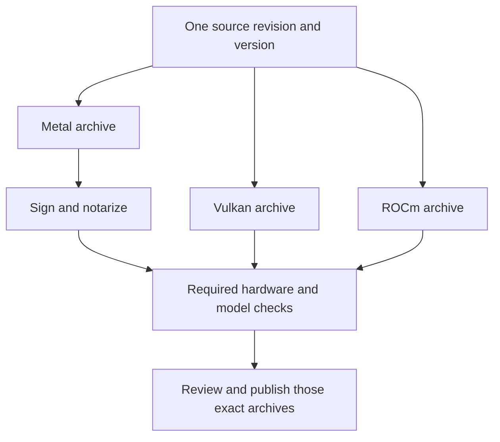

The command-line version of ZINC said “fridge.” The HTTP server said “box.”

Both were answering the same refrigerator prompt, with the same model weights, greedy decoding and one request slot on our 32 GB Radeon AI PRO R9700. Each answer sounded reasonable. The difference sent us into the GPU execution paths while preparing **ZINC 0.1.0, our first stable release for local LLM inference**.

A short prompt had found a disagreement that a fluent paragraph could hide. Following it led through request history, memory allocation, the test harness and eventually the reference executable itself.

We are still qualifying the release. The recent work has made the meaning of “stable” much more concrete.

## A request can inherit more than conversation history

An inference engine first processes the prompt, called **prefill**, then generates tokens one at a time. ZINC has several ways to execute those operations. Their floating-point reductions can produce slightly different numbers, enough to change a greedy choice when two words are close.

Our Qwen mixture-of-experts path exposed that distinction on a **19-token prompt**. The command line used batched prefill with one state-space scan; the server selected a different path for short prompts. We brought the configured single-slot ROCm paths into agreement and added tests around the short-prompt boundary.

Then the stronger checks found something less obvious. A dense model could give the expected answer, process a long request, and give a different answer to the original short prompt afterward.

The long request had allocated scratch buffers. Later decode code treated the buffers’ existence as permission to use a different arithmetic path. The allocation was cached, so the next request inherited that decision.

| Trigger                                    | What we found                                   | What the regression now checks                         |
| ------------------------------------------ | ----------------------------------------------- | ------------------------------------------------------ |
| The same short prompt through CLI and HTTP | Different short-prompt execution paths          | Complete frozen continuations through both entrypoints |
| A short request after a long one           | Cached scratch changed decode eligibility       | Correct short answers after context and error recovery |
| An 8K coding session with Gemma 31B        | Weights and cache fit, prompt scratch did not   | Chunked prefill with preserved positions and history   |
| A clean reference checkout                 | Its server executable reported another revision | Executable identity and unchanged reference libraries  |

_Four release-testing clues. Each became a test that exercises the condition which exposed the failure._

The scratch buffers can remain cached. The permission to use a particular decode path now belongs to the current request. That distinction is small in code and consequential in a server that keeps running between users’ requests.

Our [single-slot consistency report](/zinc/docs/rocm-single-slot-correctness/) records the controls and fixes. The test sequence now asks the short questions again after cancellation, a nearly full context, malformed JSON and an oversized request. It compares complete reference continuations, including whitespace.

A healthy endpoint and a nonempty answer would have missed this bug.

## Fitting the model was only the first memory budget

Gemma 4 31B presented a different problem. On the R9700, the model and its 8K key/value cache could load, but whole-prompt prefill needed more temporary memory than remained. The fallback processed the prompt serially. One captured **5,037-token OpenCode request spent about 199 seconds in that fallback before its first response**.

The [bounded prefill fix](/zinc/docs/rocm-gemma-bounded-prefill/) tries smaller scratch allocations before executing any prompt layer. It halves the capacity until a workable chunk fits, with a defined minimum. Allocation failures can trigger that retry; execution and shape errors keep their original failure paths.

Each chunk must retain its absolute position and attend to the earlier chunks. Starting each chunk’s positions at zero would save memory while changing the computation. We therefore force tiny 16-token chunks in a separate regression and compare every continuation token and the full text with the reference. That exercises nonzero offsets and short final chunks even when the GPU has enough space for a larger allocation.

We also stopped reserving an unused 220.5 MiB workspace on the affected dense quantized path. On a crowded 32 GB card, an allocation needs a reason to exist.

## The coding client supplied a different kind of test

We ran actual OpenCode sessions against the packaged executable. The core fixtures asked for a rate limiter, a multi-file shopping cart and a Python NDJSON command-line tool. Independent acceptance tests failed before each task and ran again after the client exited. The model had to read, edit and invoke tools; the supervisor supplied no implementation edits or repaired model responses.

On preview `11519aaa`, Gemma 31B completed those three fixtures at 8K, passing all ten acceptance tests, with a **600-second budget per fixture**. The earlier 300-second trial remains recorded as a timeout. The context, deadline and executable identity travel with each result.

That evidence covers those bounded tasks. The [earlier repository trial](/blog/2026-10-26-from-fast-tokens-to-a-verified-coding-task-on-rdna4/) describes getting a feature through review, including tool-output limits and an initial green check that missed two contract violations.

## Eventually we had to test the reference

The reference engine deserves the same scrutiny as ZINC.

During the latest R9700 validation, a HIP reference checkout was at the policy revision, `5f436dddb`. Its server executable reported `b96806d96`, an older ancestor. We had recorded the executable’s hash correctly in earlier reports, but also attached the intended checkout revision to it.

We corrected those reports. Their comparisons remain observations against the recorded executable bytes; the claim that this HIP executable verified the intended policy revision is withdrawn. The separately observed OpenCode fixture outcomes retain their own scope.

There was another surprise. Building a missing tokenizer tool replaced sibling shared libraries while leaving the server executable unchanged. Hashing the server alone would have missed that change.

The release checks now capture both executables and their adjacent ggml/llama libraries before the reference version probe. Those identities must remain unchanged through model validation. Installed ZINC runs without inherited model or loader overrides, while reference processes explicitly select their own libraries. The [reference audit](/zinc/docs/rdna4-reference-validation/) preserves the failure and rebuild identities.

We also require the reference to use the tested backend: Metal against Metal, Vulkan against Vulkan, and ROCm against HIP/ROCm. Different quantized backends can make different greedy choices. Our agreement policy allows a narrowly defined near-tied second choice, then feeds that choice into the reference and requires the remaining suffix to match. It cannot excuse an unrelated later error.

This work changed how we read a green check. We now ask which executable ran, which reference libraries were supplied, which model bytes it consumed, and what happened before the checked request.

## The release starts with an archive

Users will install an archive. Its shaders, runtime dependencies, model tooling and embedded identity all have to survive extraction outside our checkout.

The automated packaging jobs build three planned distributions:

| Platform      | Backend | Runtime baseline                                          |
| ------------- | ------- | --------------------------------------------------------- |
| Apple Silicon | Metal   | macOS 15+, also respecting each chip’s factory OS minimum |
| Linux x86-64  | Vulkan  | glibc 2.35+ and a compatible Vulkan 1.3 driver            |
| Linux x86-64  | ROCm    | glibc 2.39+, ROCm 7.2.4, AMD `gfx1201`                    |

_The planned 0.1.0 archive baselines. GPU drivers and model weights remain separate installations._

The hardware policy is more specific than these three rows. It requires four Apple GPU-family profiles, Vulkan checks on RDNA3, RDNA4, Strix Halo and Intel Xe2, and the ROCm RDNA4 profile. CUDA remains experimental and source-only for this release.

Signing and testing also have an order. The Metal archive must be signed and notarized before its final hardware qualification. Publication then uses the validated archives unchanged.

_The release flow preserves artifact identity through signing, qualification and publication. The bytes users download must be the bytes the hardware jobs tested._

The R9700 now has an isolated non-root worker for both backends, sharing one GPU reservation. Readiness jobs can exercise a successful main-branch preview while the rest of the release infrastructure is being prepared. Their reports are deliberately kept separate from signed-candidate qualification.

## Where the road stands today

As of October 31, the fresh [ROCm worker run](https://github.com/zolotukhin/zinc/actions/runs/41268656993) and [Vulkan worker run](https://github.com/zolotukhin/zinc/actions/runs/41269120680) pass all twelve required model/backend rows on the R9700, using unsigned preview commit `dbbfff54`. Across the two runs, **575 of 576 CLI token choices match exactly**, with one policy-qualified near-tie. The complete API checks pass, including active chat-stream cancellation and recovery, and neither run leaves a GPU process behind.

The model checks use 4K context, F32 key/value caches, one slot and each backend's default multi-token prediction setting. Each model has three frozen 16-token continuations, supplemented by the tokenizer, HTTP and boundary checks.

Those are useful results on one board. The remaining seven worker roles and Apple signing credentials still need provisioning, and all nine hardware profiles need qualification against the final candidate. The small starter model also needs its promotion review. The [release readiness plan](https://github.com/zolotukhin/zinc/blob/main/docs/releases/0.1.0-plan.md) tracks those remaining gates.

The refrigerator prompt remains in the tests. So do the long request, the cancelled stream, the failed shorter coding trial and the old reference identity. Keeping those cases gives the next optimization something concrete to answer to.

The first stable version will be ready when someone can download it, run it on a listed GPU, and get the behavior its report promises.
