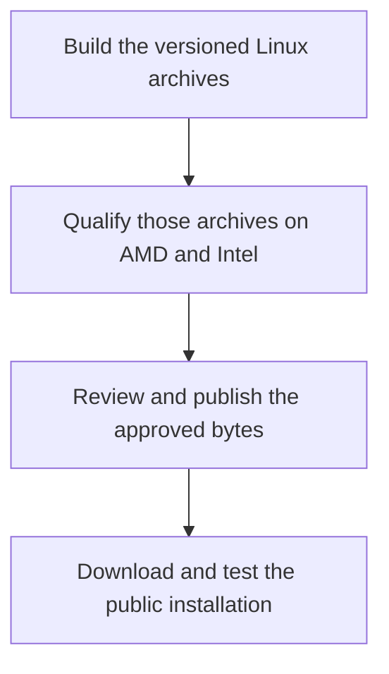

After publishing ZINC 0.1.0, we downloaded it again.

All nine public files had to match the approved release bundle. Then, in isolated installation directories, both Linux backends went through an upgrade from the release candidate to stable, a rollback, and a stable reinstall. The command links and cache markers had to survive the trip.

**[ZINC 0.1.0 is available](https://github.com/zolotukhin/zinc/releases/tag/v0.1.0).** It is our first stable binary release for local large language model inference, with Vulkan on AMD and Intel GPUs and a separate AMD ROCm build. You can install a versioned archive, download a managed GGUF model and run it without building the engine yourself.

The [road to this release](/blog/2026-10-31-zinc-0-1-0-and-the-refrigerator-that-changed-our-tests/) involved some surprisingly small prompts and some very large debugging sessions. The result is a specific set of binaries, hardware combinations and model behaviors that we can point to and reproduce.

## What ships in the first stable release

There are two archives and three qualified GPU profiles:

| Archive backend | Qualified hardware                 | Runtime requirements                                          |
| --------------- | ---------------------------------- | ------------------------------------------------------------- |
| Vulkan          | AMD Radeon AI PRO R9700            | Linux x86_64, glibc 2.35+, Vulkan 1.3 and a compatible driver |
| Vulkan          | Intel Arc Pro B70 / Xe2            | Linux x86_64, glibc 2.35+, Vulkan 1.3 and a compatible driver |
| ROCm            | AMD Radeon AI PRO R9700, `gfx1201` | Linux x86_64, glibc 2.39+ and ROCm 7.2.4                      |

_The stable launch matrix. The same Vulkan archive was tested on both GPU vendors; ROCm is a separate executable and download._

The [Vulkan archive](https://github.com/zolotukhin/zinc/releases/download/v0.1.0/zinc-v0.1.0-linux-x86_64-vulkan.tar.gz) includes compiled SPIR-V shaders, so installation does not require a shader compiler. The [ROCm archive](https://github.com/zolotukhin/zinc/releases/download/v0.1.0/zinc-v0.1.0-linux-x86_64-rocm.tar.gz) uses HIP and runtime kernel compilation. It needs the documented HIP, hipRTC and hipBLAS libraries, plus HIP and rocWMMA headers. Ubuntu 24.04 is its reference userspace.

GPU drivers and model weights are installed separately. The operating-system floor describes executable compatibility; the [release validation](https://github.com/zolotukhin/zinc/releases/download/v0.1.0/validation.json) records the actual GPU and driver combinations tested.

Metal remains an unsigned Apple Silicon preview. CUDA remains experimental and source-only. RDNA3, Strix Halo and other Intel cards can be further qualification targets, but they are outside this launch matrix. There is no stable 0.1.0 archive for Linux ARM64, musl/Alpine or native Windows.

## Install a pinned version and run a model

Download the installer from the versioned release:

```bash
curl -fL https://github.com/zolotukhin/zinc/releases/download/v0.1.0/install.sh \
  -o install.sh
```

Inspect it, then run `ZINC_VERSION=v0.1.0 bash install.sh` for Vulkan. For ROCm, use `ZINC_VERSION=v0.1.0 ZINC_BACKEND=rocm bash install.sh` instead. These are alternative installations; the backend is selected when choosing the archive.

The installer checks the archive and its contents, runs the new executable's version probe and activates it through a symlink. The default command is `~/.local/bin/zinc`; use `export PATH="$HOME/.local/bin:$PATH"` if that directory is not already on your shell's path. It does not require Zig, Python or a source checkout.

For AMD Vulkan, first set `export RADV_PERFTEST=coop_matrix` in the terminal. Intel Vulkan and ROCm do not need that AMD setting. Then start with Qwen 3.5 9B:

```bash
zinc --version
zinc --check
zinc model list --all
zinc model pull qwen35-9b-q4k-m
zinc --model-id qwen35-9b-q4k-m --context 4096 \
  --chat --prompt "Explain a ring buffer."
```

Managed downloads use immutable upstream revisions and SHA256 pins. That matters when reporting a bug: a model name alone does not identify its weights, quantization or conversion. The managed ID and release version give us a much better starting point.

The [installation guide](/zinc/docs/binary-releases/) covers custom directories, manual verification, runtime requirements and rollback. Omitting `ZINC_VERSION` selects the latest published stable release; setting it explicitly makes an installation reproducible.

## The models we qualified

The Vulkan matrix includes seven pinned GGUF models. ROCm includes the six larger models. The set includes dense models and mixture-of-experts (MoE) variants:

| Model and quantization      | Vulkan    | ROCm                 |
| --------------------------- | --------- | -------------------- |
| Qwen 3 0.6B Q8_0            | Qualified | Outside this release |
| Qwen 3.5 9B Q4_K_M          | Qualified | Qualified            |
| Qwen 3.6 27B Q4_K_M         | Qualified | Qualified            |
| Qwen 3.6 35B-A3B UD-Q4_K_XL | Qualified | Qualified            |
| Qwen 3.8 27B Q4_K_M         | Qualified | Qualified            |
| Gemma 4 26B-A4B MoE Q4_K_M  | Qualified | Qualified            |
| Gemma 4 31B Q4_K_M          | Qualified | Qualified            |

_These are the pinned model files used in release qualification. The exact hashes and context limits are published with the release._

The starter was qualified at **2,048 context tokens**. The six larger models were qualified at **4,096**, using one request slot and each backend's default key/value cache and multi-token prediction settings. Larger contexts, alternative cache formats and concurrent serving need their own checks. The [release policy](https://github.com/zolotukhin/zinc/releases/download/v0.1.0/release-policy.json) makes those boundaries explicit.

Qwen 3.5 9B is our starting chat recommendation. The 0.6B model is useful for a small Vulkan installation check, but it is not recommended for chat, reasoning or coding. Larger models need space for their weights, the key/value cache and temporary execution buffers; fitting a GGUF file into 32 GB is only part of the memory budget.

One catalog issue has already surfaced: the shipped 0.1.0 Intel profile omits Qwen 3.8, although its direct GGUF runs passed qualification. [The follow-up fix](https://github.com/zolotukhin/zinc/pull/73) corrects managed-model selection and adds a regression covering all seven Intel models. The quickstart above uses Qwen 3.5 9B.

## How ZINC runs the model

ZINC reads GGUF model files directly, including their weights and metadata, and executes the model through GPU kernels. Quantization stores weights in fewer bits to reduce their size and memory traffic; names such as Q4_K_M and Q8_0 identify particular quantization layouts. Its host code and build system use Zig, with 0.17.0 pinned for this release. A Python machine-learning framework is not part of the runtime.

Inference has two distinct workloads. **Prefill** processes the input prompt; **decode** generates the next token repeatedly. Prefill can exploit batches of tokens and matrix operations. Decode often spends much of its time reading quantized weights and the attention cache, with submission overhead becoming more visible on small models.

On Vulkan, ZINC builds and records the decode graph, then replays it for subsequent tokens. Quantization handling lives in the GPU kernels, so the dispatcher can select the appropriate Q4_K, Q6_K, Q8_0 or floating-point operation. Fused normalization, gating and projection work reduces intermediate memory traffic. ROCm uses its own HIP execution path.

The architecture is described in the [engine overview](/zinc/docs/spec/). For 0.1.0, several less glamorous changes were equally useful: Vulkan uploads reuse a staging window capped at **64 MiB**, and pipeline loading selects kernels for the loaded model. Those changes reduce temporary memory and unnecessary initialization work without being presented as decode speedups.

## What the GPU qualification checks

A model loading and producing a fluent answer is a weak test of an inference engine. We compare tokenization, complete greedy continuations and detokenized text with a pinned llama.cpp GPU reference. The reference backend follows the tested backend: Vulkan for Vulkan, HIP/ROCm for ROCm.

The native correctness reference uses F32 key/value storage, while ZINC is checked at its backend defaults. That reference stays pinned independently of the upstream revision used for new performance comparisons.

Both Vulkan cards passed **376 numerical shader cases each**. The ROCm executable passed **305 cases covering partial tiles and buffer boundaries** against its embedded kernel source. These include conditions that the actual model dimensions exposed, rather than only convenient square matrices.

Gemma supplied two particularly useful boundaries. Its sliding attention layers have a **1,024-token window**, so short prompts could pass while longer requests attended to the wrong history. Its MoE down projection also has a 704-column dimension: a kernel processing only full 128-column tiles dropped the final 64 columns. We corrected the window handling and partial tiles, then kept numerical regressions and full model continuations beyond the window.

The final archive results are **432/432 exact native choices on R9700 Vulkan, 431/432 on Intel Vulkan, and 382/384 on R9700 ROCm**. The three differing choices satisfy the unchanged near-tie policy: a narrowly separated second-ranked reference choice must also survive a reference replay of the remaining suffix and complete text checks. These counts describe agreement on the frozen tests, not a model-accuracy benchmark.

Server checks extend beyond the first successful request. They cover raw and chat completions, streaming, cancellation during generation and active prefill, malformed requests, context limits and recovery. Short reference requests run again after disruptive requests to catch state leaking between them. Both Gemmas cross their sliding window through the command line and HTTP.

The [final qualification report](/zinc/validation/release-candidate-0.1.0-2026-11-03.json) binds those results to the archive digests, model files, source and reference identities.

## Use the server from a browser or API client

Vulkan includes the browser chat UI; `zinc chat --model-id qwen35-9b-q4k-m` launches that workflow. ROCm provides CLI and HTTP chat/completion routes without the built-in browser UI or hot model switching.

For an explicit single-slot API server on either backend:

```bash
zinc --model-id qwen35-9b-q4k-m \
  --context 4096 --parallel 1 --port 9090
```

In another terminal, send a bounded chat request:

```bash
curl -sS http://127.0.0.1:9090/v1/chat/completions \
  -H 'Content-Type: application/json' \
  -d '{
    "model": "qwen35-9b-q4k-m",
    "messages": [{"role": "user", "content": "Explain a ring buffer."}],
    "max_tokens": 128,
    "stream": false
  }'
```

Setting `stream` explicitly keeps the response format consistent across the two server implementations. The [API guide](/zinc/docs/api/) lists endpoint coverage and backend differences; the [OpenCode guide](/zinc/docs/opencode/) covers connecting a coding client.

## Real coding tasks have separate acceptance tests

During the pre-release work, we ran actual OpenCode 2.0.21 sessions on Intel against a packaged development build. The tasks covered a TypeScript rate limiter, a multi-file shopping cart fix and a Python NDJSON command-line tool.

Across all seven models, the API probes passed **203/203**. The six larger models completed **18/18 coding fixtures**. Each fixture required independent acceptance tests to pass, protected files to remain intact, the client to exit successfully and the server to recover. A zero exit code without a working implementation did not count. No supervisor supplied implementation edits or repaired model tool calls.

The starter completed **0/3** tasks, and a separate native-engine control also completed none. That is why our smallest successful coding recommendation from this campaign starts at 9B.

These results belong to the archive and settings in the [Intel coding report](/zinc/docs/intel-opencode-validation/). That campaign used larger, model-specific contexts and a 15-minute fixture budget. It is separate from the final release's 2K/4K inference qualification, and it does not establish general coding ability. Keeping those distinctions makes the results useful when choosing a model and context budget.

## Publishing preserves the tested bytes

Both stable archives come from the same [frozen source commit](https://github.com/zolotukhin/zinc/commit/c3d4c0a23defa92b12394af09750554615b3cf41). The candidate goes through packaging, numerical and model qualification, aggregation and provenance checks before the protected publisher can release it.



_The release process carries the same archive identity through hardware qualification and public installation._

The release candidate and final version have separate embedded versions and separate qualification records. The final release is not an RC archive renamed after testing.

Alongside the two archives, the release publishes an installer, SHA256 checksums, a per-file manifest, the model/qualification policy, validation results, release notes and signed provenance. The [provenance verification instructions](/zinc/docs/binary-releases/#verify-a-manual-download) explain how to verify the GitHub artifact attestations against the repository and candidate workflow.

An attestation connects an asset's digest to its build workflow and source identity. The numerical and model tests establish a different property: what those bytes actually did on the tested GPUs. We want both records to travel with the download.

After publication, both public installation jobs passed and all nine anonymous downloads matched the certified bundle. The separate [installation rehearsal](/zinc/validation/public-install-upgrade-0.1.0-2026-11-03.json) then exercised RC installation, stable upgrade, rollback, stable reinstall and default stable selection for both backends. It checked command links and cache sentinels in temporary prefixes; those CPU-only installation checks complement the GPU qualification.

For an installed version, `bash install.sh --rollback` restores the previous installation. The installer switches the executable and matching assets together, while model downloads remain separate. Stop a running server before switching the version used for its next launch.

## Performance and the next Intel work

We have model-specific performance gains, and substantial gaps still to close.

On the R9700, correcting Gemma 26B's ROCm partial-tile and router-precision paths made fast batched prefill usable with the reference checks intact. The revalidated incident-context workload used a 4K context, one slot and F32 key/value storage. It measured about **3,703 prefill tokens/s versus 2,542 for llama.cpp**, and **98.8 decode tokens/s versus 75.1**, with multi-token prediction off for both.

The [report from three rounds on source builds](/zinc/benchmarks/2026-11-03T09-00-39-rdna-rocm-gemma4-26b-a4b-q4k-m-revalidated.json) records the exact models, executables, reference revision and samples. Those are measurements for that configuration, separate from qualification of release archives.

Intel has more work ahead. The [recorded seven-model diagnostic](/zinc/docs/intel-performance/) has slower decode than its llama.cpp reference on every model and mixed prefill results. It used one round, so it gives us directions for optimization rather than a headline campaign. Faster loading and lower staging memory do not settle those throughput gaps.

The next step is to run against the latest upstream llama.cpp, profile the slow paths and retain correctness and recovery checks through each change. Native Intel compute support through Level Zero/oneAPI follows that Vulkan work, with kernel and driver choices based on the live stack. It will need its own qualification. Metal's stable hardware coverage and signing, CUDA development, larger contexts and concurrent workloads also remain separate work.

For now, 0.1.0 gives us a permanent release to install and an exact baseline for the next improvement. Start with the [Linux installation guide](/zinc/docs/binary-releases/). If something goes wrong, include the version, GPU/driver, managed model ID, context and a prompt or request that reproduces it. Those details are how a surprising answer becomes the next regression test.
